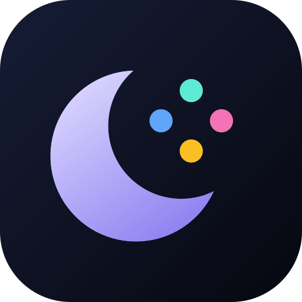
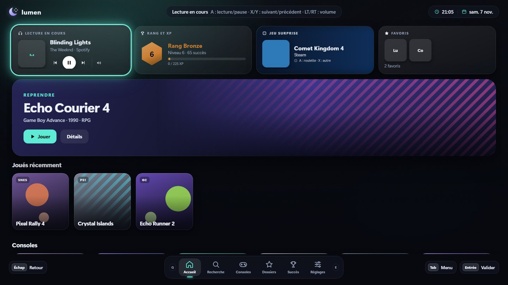
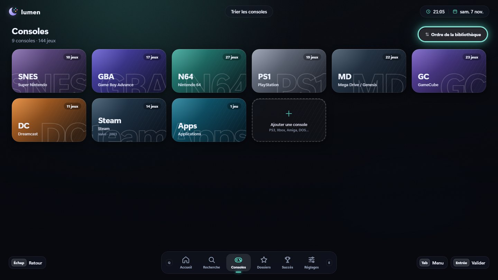
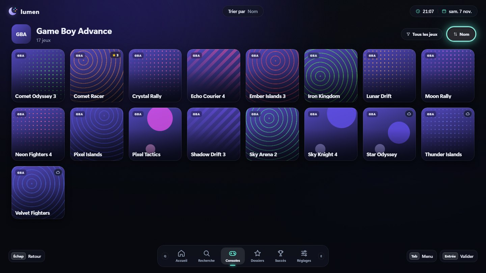
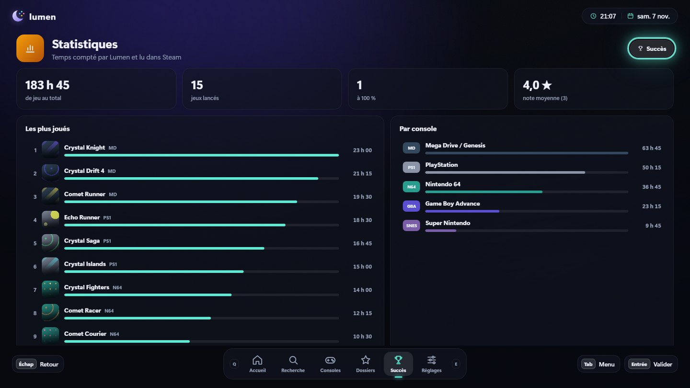
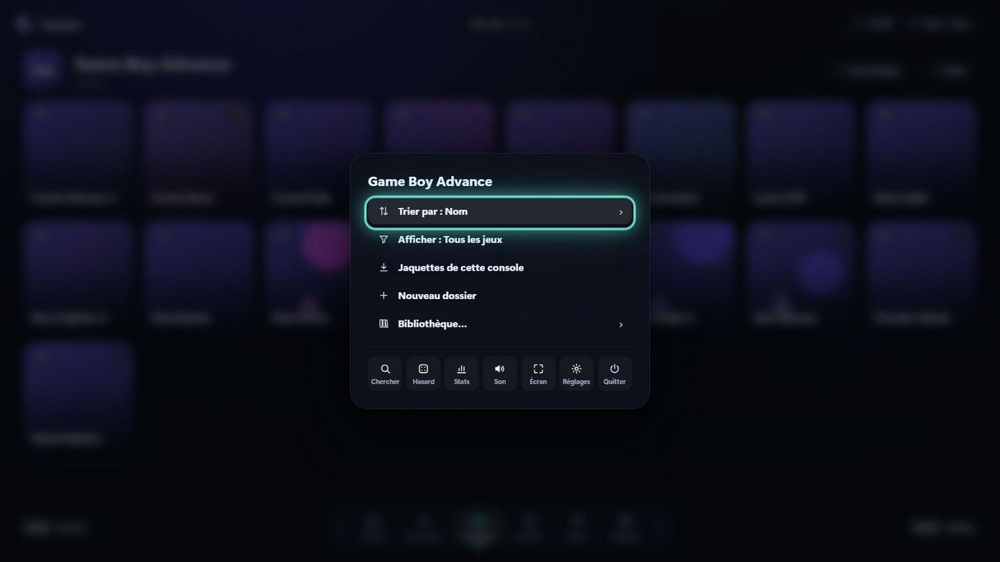

<div align="center">



# Lumen

**Tous tes jeux au même endroit, à piloter à la manette.**

ROMs, Steam, Epic, GOG, RomM et tes applications dans une seule interface plein écran pour Windows.

[](https://github.com/Flaimeur/Lumen/releases/latest)
[](https://github.com/Flaimeur/Lumen/releases/latest)
[](https://github.com/Flaimeur/Lumen/releases)

[Télécharger](https://github.com/Flaimeur/Lumen/releases/latest) · [Fonctionnalités](#fonctionnalités) · [Prise en main](#prise-en-main) · [Contrôles](#contrôles) · [Développer](#développer)



</div>

Lumen range ta bibliothèque, trouve les images de tes jeux et lance tes émulateurs et launchers. Il n'inclut ni jeux ni émulateurs.

## Fonctionnalités

- **Une seule bibliothèque** : ROMs (un dossier par console, noms ES-DE), Steam (installés ou non), Epic, GOG, serveur RomM, applications Windows, et tes propres consoles (PS3, Xbox, Amiga…).
- **De belles images** : jaquettes iiSU de la bonne console via iiDB, SteamGridDB, libretro-thumbnails, ou tes propres images.
- **Succès** : Steam (lus en local) et RetroAchievements, avec XP, rangs, coupe d'or à 100 % et bannière « Succès débloqué » par-dessus le jeu.
- **Statistiques et notes** : temps de jeu (Lumen et Steam), jeux les plus joués, temps par console et par semaine, notes sur 5 étoiles.
- **Manettes** : PS4, PS5 (DualSense en Bluetooth compris), Xbox et Switch avec les bons symboles ; profils manette → clavier pour les jeux qui ne gèrent pas la manette.
- **Accueil à ton goût** : widgets (lecture en cours Spotify/YouTube avec volume, météo, rang, jeu surprise…), 15 fonds animés, styles tout prêts.
- **Tri, filtres et roulette** : par nom, note, temps de jeu, progression ; jeu au hasard avec options (jamais joués, sans les 100 %…).
- **Toujours à jour** : mises à jour automatiques, sauvegarde et restauration de la configuration.

<table>
  <tr>
    <td></td>
    <td></td>
  </tr>
  <tr>
    <td></td>
    <td></td>
  </tr>
</table>

## Prise en main

1. Télécharge `Lumen-Setup-x.y.z.exe` depuis la [dernière version](https://github.com/Flaimeur/Lumen/releases/latest) et lance-le.
2. Au premier démarrage, l'assistant te guide : dossier des ROMs, Steam/Epic/GOG, RetroArch, manette, style d'accueil et images.
3. C'est tout : les mises à jour suivantes s'installent toutes seules.

> [!NOTE]
> **« Windows a protégé votre ordinateur » ?** L'installateur n'est pas signé avec un certificat payant, alors SmartScreen affiche cet avertissement la première fois. Clique sur **Informations complémentaires**, puis sur **Exécuter quand même**.
>
> Si le navigateur bloque le fichier (« n'est pas fréquemment téléchargé »), ouvre le menu **⋯** du téléchargement → **Conserver** → **Conserver quand même**. Le code est entièrement ouvert ici.

### Ranger ses jeux

Un sous-dossier par console dans ton dossier de ROMs, avec les noms d'ES-DE :

```
ROMs/
  snes/   gba/   n64/   psx/   ps2/   gc/   wii/   switch/   windows/ ...
```

Le dossier `windows` accepte des raccourcis `.lnk` / `.url`. Pour une plateforme non prévue, utilise **Consoles → Ajouter une console** (dossier, extensions, émulateur).

> [!TIP]
> Nomme tes ROMs selon No-Intro / Redump : Lumen trouve alors presque toujours leur jaquette.

## Contrôles

| Action | Manette | Clavier |
|---|---|---|
| Naviguer | Croix / stick gauche | Flèches |
| Valider / Jouer | A | Entrée |
| Retour | B | Échap |
| Favori | X | F |
| Détails | Y | I |
| Onglet précédent / suivant | LB / RB | Q / E |
| Lettre précédente / suivante (volume sur le widget musique) | LT / RT | Page préc. / suiv. |
| Menu rapide | Start / Select | Tab ou clic droit |
| Couper / remettre le son | — | M |
| Quitter le jeu en cours | Select + Start maintenus 1,5 s | Ctrl + Maj + Q |
| Plein écran | — | F11 |

## Images et médias

Lumen cherche, pour chaque jeu, une image du même nom que la ROM dans `<médias ES-DE>/<console>/<type>/` ou `<ROMs>/<console>/media/<type>/`.

| Dossier `<type>` | Utilisé pour |
|---|---|
| `boxart`, `icons`, `covers`, `miximages` | tuile du jeu (format carré conseillé) |
| `heroes`, `banners`, `fanart` | bannière d'accueil et fond |
| `logos`, `marquees` | logo sur la bannière |
| `soundbites` | extrait audio joué à la sélection |
| `videos` | vidéo lue dans la tuile |

Le plus simple reste les boutons intégrés : **Images iiDB** (jaquettes iiSU, icônes, logos, soundbites), **SteamGridDB** pour les jeux PC, et **Télécharger les jaquettes manquantes** (libretro-thumbnails). Clic droit sur un jeu → **Changer les images** pour choisir toi-même.

## RomM

Lumen affiche les jeux d'un serveur [RomM](https://romm.app) (4.x / 5.x) à côté des tiens :

1. Dans RomM : **Administration → Client API Tokens** → crée un jeton (`roms.read` suffit).
2. Dans Lumen : **Réglages → Comptes → RomM** → adresse du serveur et jeton, puis **Tester la connexion**.

Les jeux RomM portent un nuage ; **A** les télécharge puis les lance, et ils restent ensuite sur le PC. Le jeton est chiffré par Windows.

## Émulateurs

RetroArch est détecté automatiquement. Les autres émulateurs (Dolphin, PCSX2, Cemu…) se règlent dans **Réglages → Émulateurs**, et chaque console a une commande modifiable :

```
"{retroarch}" -f -L "{retroarchDir}\cores\snes9x_libretro.dll" "{rom}"
```

## Développer

Il faut [Node.js](https://nodejs.org) 20 ou plus.

```bash
npm install
npm start              # plein écran
npm run windowed       # en fenêtre
npm run preview        # interface seule dans le navigateur, avec des données de démo
npm run check          # tests du scanner et des commandes
npm run dist           # installateur Windows dans dist/
```

> [!TIP]
> Si `npm install` n'a pas téléchargé Electron : `node node_modules/electron/install.js`.

L'icône se régénère à partir de `build/icon.svg` avec `npm run icon`.
